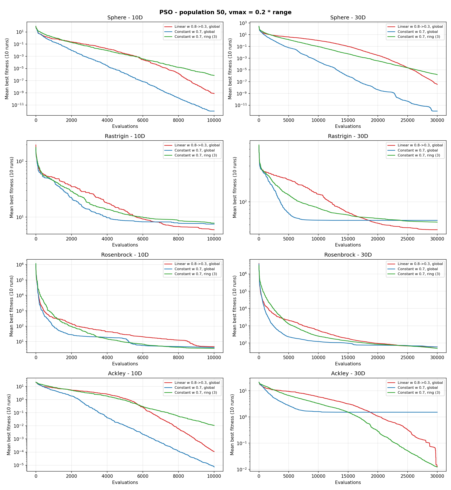

# AP9EV exercise 4

Project for the Evolutionary Computation Techniques class. Assignment 4: Particle Swarm Optimization.

Author: [Ondřej Hruboš](https://github.com/hruboson), [Github repository](https://github.com/hruboson/AP9EVexN)

This implementation uses a small object-oriented structure (`Particle` and `Swarm` classes) and a single `run_pso` function that runs one optimisation. The variants differ only in their parameters, so they all share the same code.

**Test functions** (minimisation, in the `OBJECTIVES` dictionary together with their search range): Sphere ([-5.12, 5.12]), Rastrigin ([-5.12, 5.12]), Rosenbrock ([-5, 10]) and Ackley ([-32.768, 32.768]). Each is tested in 10 and 30 dimensions.

**PSO update rule:**
- `v = w * v + c1 * r1 * (pbest - x) + c2 * r2 * (nbest - x)`, then `x = x + v`
- `r1` and `r2` are random numbers from [0, 1], drawn separately for every dimension.
- The velocity of each dimension is clamped to `vmax = 0.2 * (upper - lower)`.
- Particles that leave the search range are **not repaired and not evaluated** (they still move and may fly back inside). They do not consume any function evaluations and cannot update their personal best.

**PSO variants** (in the `VARIANTS` dictionary):
- **Linear w 0.8->0.3, global:** inertia weight decreases linearly from 0.8 to 0.3 with the number of used evaluations, c1 = c2 = 2.0, global (star) topology, where every particle follows the best personal best of the whole swarm.
- **Constant w 0.7, global:** constant inertia weight w = 0.7, c1 = c2 = 1.49618, global topology.
- **Constant w 0.7, ring (3):** same parameters as above, but with ring topology. Each particle follows the best personal best among itself and its two direct neighbours (neighbourhood size 3, indices wrap around).

**PSO setup:** population 50, `MAXFES = 1000 * D` evaluations per run (10 000 for 10D, 30 000 for 30D), 10 runs per variant and function. The random generator is seeded once at the start (`SEED = 42`), so the whole experiment is reproducible.

# Experiments

Each PSO variant runs 10 times on each test function in both dimensions. The convergence graph shows the mean (over the 10 runs) of the best fitness found so far, against the number of function evaluations. The statistics (best, worst, mean, median and standard deviation of the final best fitness) are printed to the console and also saved as a table image.

# Results

Convergence graphs (means of 10 runs, **logarithmic scale**):

##### Sphere, d=10
 
| Method | Best | Worst | Mean | Median | Std |
|---|---:|---:|---:|---:|---:|
| Linear w 0.8->0.3, global | 2.007e-11 | 5.401e-09 | 7.687e-10 | 1.206e-10 | 1.584e-09 |
| Constant w 0.7, global | 7.823e-14 | 1.263e-12 | 3.914e-13 | 3.017e-13 | 3.268e-13 |
| Constant w 0.7, ring (3) | 3.513e-07 | 1.886e-06 | 7.32e-07 | 5.628e-07 | 4.233e-07 |
 
##### Sphere, d=30
 
| Method | Best | Worst | Mean | Median | Std |
|---|---:|---:|---:|---:|---:|
| Linear w 0.8->0.3, global | 8.953e-09 | 1.323e-07 | 3.425e-08 | 2.124e-08 | 3.451e-08 |
| Constant w 0.7, global | 5.564e-16 | 2.898e-12 | 3.129e-13 | 1.682e-14 | 8.622e-13 |
| Constant w 0.7, ring (3) | 7.268e-07 | 3.069e-06 | 1.599e-06 | 1.339e-06 | 7.834e-07 |
 
##### Rastrigin, d=10
 
| Method | Best | Worst | Mean | Median | Std |
|---|---:|---:|---:|---:|---:|
| Linear w 0.8->0.3, global | 2.985 | 9.427 | 5.921 | 5.483 | 2.217 |
| Constant w 0.7, global | 1.992 | 12.93 | 7.466 | 6.965 | 3.535 |
| Constant w 0.7, ring (3) | 4.009 | 12.29 | 7.763 | 7.744 | 2.677 |
 
##### Rastrigin, d=30
 
| Method | Best | Worst | Mean | Median | Std |
|---|---:|---:|---:|---:|---:|
| Linear w 0.8->0.3, global | 26.86 | 61.69 | 42.63 | 43.79 | 10.4 |
| Constant w 0.7, global | 40.79 | 75.62 | 56.71 | 54.23 | 9.512 |
| Constant w 0.7, ring (3) | 37.6 | 67.06 | 53.73 | 56.62 | 8.567 |
 
##### Rosenbrock, d=10
 
| Method | Best | Worst | Mean | Median | Std |
|---|---:|---:|---:|---:|---:|
| Linear w 0.8->0.3, global | 0.0147 | 8.971 | 4.636 | 5.105 | 2.487 |
| Constant w 0.7, global | 0.2568 | 5.817 | 4.049 | 4.36 | 1.365 |
| Constant w 0.7, ring (3) | 0.1692 | 6.766 | 3.595 | 3.055 | 2.283 |
 
##### Rosenbrock, d=30
 
| Method | Best | Worst | Mean | Median | Std |
|---|---:|---:|---:|---:|---:|
| Linear w 0.8->0.3, global | 14.09 | 86.77 | 59.91 | 80.14 | 29.53 |
| Constant w 0.7, global | 18.66 | 107.8 | 59.63 | 75.3 | 29.93 |
| Constant w 0.7, ring (3) | 8.137 | 77.05 | 49.51 | 54.27 | 26.95 |
 
##### Ackley, d=10
 
| Method | Best | Worst | Mean | Median | Std |
|---|---:|---:|---:|---:|---:|
| Linear w 0.8->0.3, global | 2.092e-05 | 0.0002635 | 0.0001102 | 0.0001087 | 7.352e-05 |
| Constant w 0.7, global | 2.473e-06 | 1.564e-05 | 7.34e-06 | 6.642e-06 | 4.041e-06 |
| Constant w 0.7, ring (3) | 0.002713 | 0.01784 | 0.01076 | 0.009935 | 0.004587 |
 
##### Ackley, d=30
 
| Method | Best | Worst | Mean | Median | Std |
|---|---:|---:|---:|---:|---:|
| Linear w 0.8->0.3, global | 0.0005531 | 0.1029 | 0.01312 | 0.001527 | 0.0301 |
| Constant w 0.7, global | 1.604e-06 | 2.012 | 1.517 | 1.712 | 0.5589 |
| Constant w 0.7, ring (3) | 0.008155 | 0.01775 | 0.01231 | 0.01242 | 0.002766 |

## Run

- Either use the prepared [`nix`](./shell.nix) shell file:
    - Install [`nix`](https://nixos.org/download/) on your system (currently only for Linux/MacOS)
    - Enter the shell: `nix-shell ./shell.nix`
    - Run the Python script: `python ./main.py`
- Use your own installation of **Python 3.14** (older versions will most likely not work due to the usage of type hints!)
    - Create a virtual environment with the attached [`requirements.txt`](./requirements.txt): 
        - Windows: `python -m venv .venv && .venv\\Scripts\\activate && pip install -r requirements.txt`
        - Linux/MacOS: `python -m venv .venv && . .venv/bin/activate && pip install -r requirements.txt`
    - Run the Python script: `python ./main.py`
    - Leave virtual environment: `deactivate`
